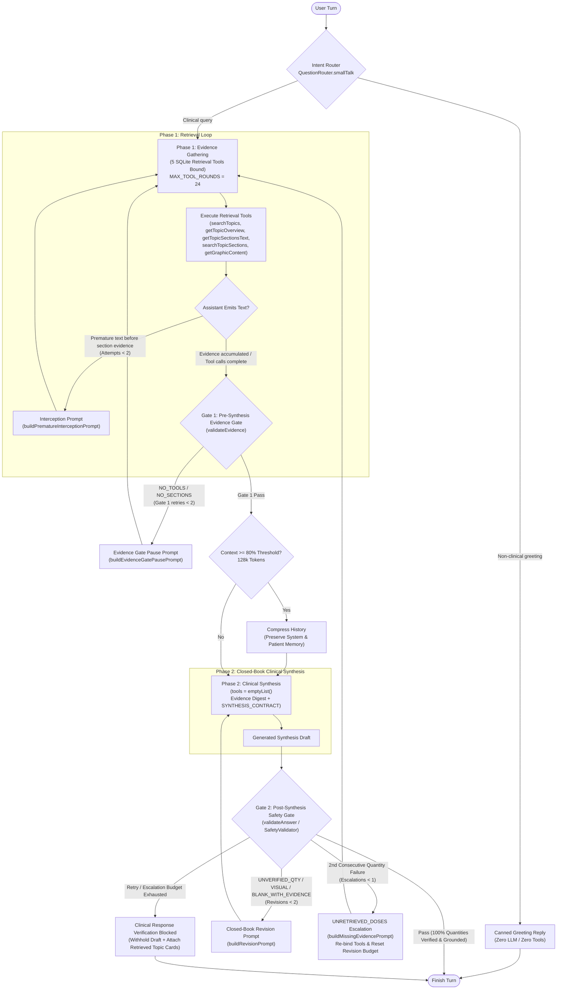
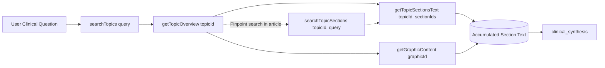
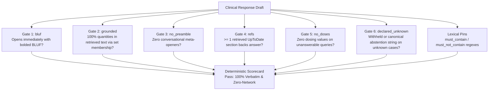

# Architectural Principles for a Universal Clinical Decision Support System Prompt Over an Offline UpToDate Corpus

## Executive Summary: From Standalone Instructions to Contract-Coupled Clinical Prompting

Designing a universal system prompt to assist physicians over an offline UpToDate database requires shifting from conventional prompt writing to contract-coupled context engineering [[1]](#works-cited). In clinical decision support (CDS), standalone large language models (LLMs) and naive retrieval-augmented generation (RAG) pipelines exhibit persistent reliability gaps [[3]](#works-cited). Across biomedical benchmarks, integrating standard RAG improves performance over baseline LLMs with a pooled odds ratio of $1.35$ ($95\%$ confidence interval: $1.19\text{--}1.53$, $P = .001$) [[5]](#works-cited), yet empirical audits demonstrate that even high-performing RAG architectures generate unsupported clinical claims in $15\%$ to $30\%$ of responses due to retrieval coverage gaps, noisy document segmentation, and parametric memory override [[3]](#works-cited). When an LLM answers a physician's query using pre-trained parametric weights rather than verified literature, slight stochastic variations in decoding or phrasing can alter drug dosages, invert diagnostic thresholds, or misstate guideline strength, directly threatening patient safety [[4]](#works-cited).

In the ClinRef AI architecture, the system prompt succeeds as a universal clinical interface precisely because it does not attempt to govern model behavior through linguistic persuasion alone [[1]](#works-cited). Instead, the system prompt operates as the declarative specification of a two-phase, deterministic state machine mirrored across both Python (`python_prototype/`) and Kotlin Multiplatform (`:shared`) stacks [[1]](#works-cited). Rather than relying on a single unconstrained generation pass, the pipeline routes incoming turns through an intent classifier that immediately resolves non-clinical small talk via a canned reply without invoking an LLM or retrieval tools, while directing all clinical queries into a strictly budgeted, multi-stage verification workflow [[1]](#works-cited).



### Deterministic State Machine Specifications

| Pipeline Stage | Tool Binding State | Execution Budgets & Thresholds | Gate Conditions & State Transitions |
| :--- | :--- | :--- | :--- |
| **Intent Routing** (`route_intent`) | Unbound (no LLM, no tools on small talk) [[1]](#works-cited) | Zero token overhead on non-clinical turns [[1]](#works-cited) | Routes small talk directly to a canned reply (`finish`); routes clinical queries to `evidence_gathering` [[1]](#works-cited). |
| **Phase 1: Evidence Gathering** (`evidence_gathering`) | 5 SQLite retrieval tools bound [[1]](#works-cited) | `MAX_TOOL_ROUNDS = 24`; Premature text interceptions: max $2$; `maxAgentIterations = 128` [[1]](#works-cited) | Loops between tool calls and tool results. Emitting clinical text before capturing evidence triggers an interception prompt [[1]](#works-cited). |
| **Gate 1: Evidence Validation** (`validate_evidence`) | Validator gate (deterministic) [[1]](#works-cited) | `maxSafetyRetries = 2`; History compression at $80\%$ of `historyCompressionThreshold` ($128,000$ default) [[1]](#works-cited) | Fails on `NO_TOOLS` or `NO_SECTIONS` and routes back to `evidence_gathering` via pause prompt; on pass, compresses history if near token limit and advances to synthesis [[1]](#works-cited). |
| **Phase 2: Clinical Synthesis** (`clinical_synthesis`) | Closed-book (`tools = emptyList()`) [[1]](#works-cited) | Single-pass synthesis per draft or revision turn [[1]](#works-cited) | Generates clinical response strictly from the accumulated evidence digest and persistent patient profile [[1]](#works-cited). |
| **Gate 2: Safety Validation** (`validate_safety`) | Validator gate (deterministic) [[1]](#works-cited) | `maxSafetyRetries = 2` revisions per draft; `MAX_EVIDENCE_ESCALATIONS = 1` [[1]](#works-cited) | Passes to finish. Initial failure (`UNVERIFIED_QTY`, `VISUAL`, `BLANK_WITH_EVIDENCE`) triggers closed-book revision. A second consecutive quantity failure triggers `UNRETRIEVED_DOSES`, handing tools back once (`evidence_gathering`) and resetting the revision budget. Exhausting budgets emits a blocked message with reference cards [[1]](#works-cited). |

As detailed in the state machine specifications above, the turn architecture enforces a hard boundary between open-book retrieval (`evidence_gathering`) and closed-book generation (`clinical_synthesis`), policed by deterministic pre-synthesis (`validate_evidence`) and post-synthesis (`validate_safety`) gates [[1]](#works-cited). Because the surrounding state graph enforces tool execution order and quantitative grounding deterministically, the universal system prompt (`SystemPrompt.STATIC_CLINICAL_GUIDANCE`, compactly engineered at approximately $2.6\text{ KB}$) is freed from bloated meta-instructions and defensive repetition [[1]](#works-cited).

Synthesizing this pipeline architecture with contemporary clinical informatics literature establishes six foundational principles that govern a universal clinical system prompt:

1. **Prefix Invariance and Dynamic Context Bifurcation**: Preserves key-value (KV) cache hits across multi-turn tool loops and multi-patient consultations [[1]](#works-cited).
2. **Corpus-Aware Multi-Hop Retrieval and Dose Provenance**: Navigates the structural asymmetry between disease management topics and drug monographs inside the offline UpToDate SQLite schema [[1]](#works-cited).
3. **Question-Adaptive Information Architecture and Cognitive Load Minimization**: Combines a mandatory Bottom Line Up Front (BLUF) with open headings derived from retrieved sections rather than rigid, error-prone output templates [[1]](#works-cited).
4. **Epistemic Fidelity, GRADE Lexicon Preservation, and Canonical Abstention**: Prevents modal verb flattening (`recommend` vs. `suggest` vs. `may`), enforces verbatim numeric grounding, and guarantees deterministic abstention when evidence is absent [[1]](#works-cited).
5. **State-Specific Remediation Prompts and Tool-Rebinding Escalation**: Recovers from hallucinated or unretrieved drug doses by dynamically returning retrieval tools to the model (`UNRETRIEVED_DOSES`) rather than trapping it in a closed-book revision dead end [[1]](#works-cited).
6. **Deterministic Verification and Telemetry-Driven Prompt Governance**: Maps every clause in the system prompt directly to an automated, non-stochastic evaluation check (`grounded`, `bluf`, `no_preamble`, `refs`, `no_doses`, `declared_unknown`) [[1]](#works-cited).

### Comparison: Naive Medical RAG vs. Contract-Coupled Universal Prompt

| Architectural Dimension | Naive Medical RAG System Prompt | Contract-Coupled Universal Prompt (ClinRef AI Standard) | Clinical & Computational Impact |
| :--- | :--- | :--- | :--- |
| **System Message Structure** | Single monolithic string concatenating static rules, patient EHR data, and retrieved chunks [[8]](#works-cited). | Bifurcated into invariant `STATIC_CLINICAL_GUIDANCE` ($\approx 2.6\text{ KB}$, cache-controlled) and dynamic `patientContextBlock(profile)` [[1]](#works-cited). | Preserves byte-for-byte prefix cache across up to $24$ tool rounds; yields $17.4\times$ to $50\times$ faster prefill in multi-step agent turns [[1]](#works-cited). |
| **Retrieval Instruction** | Generic directive to search vector chunks for relevant medical text [[3]](#works-cited). | Schema-specific funnel (`searchTopics` $\rightarrow$ `getTopicOverview` $\rightarrow$ `getTopicSectionsText`) plus explicit Dose Provenance cross-topic rule [[1]](#works-cited). | Prevents outline-only hallucination (`NO_SECTIONS`) and forces cross-reference to Lexidrug topics (`topicType == "drug"`) for dosing [[1]](#works-cited). |
| **Output Taxonomy** | Fixed, mandatory clinical headers (e.g., Etiology, Diagnosis, Preferred Therapy, Dosing) [[1]](#works-cited). | Mandatory BLUF followed by open, question-adaptive bold headings derived from retrieved section titles plus Empty Header Rule [[1]](#works-cited). | Eliminates malformed headers (e.g., "Preferred Etiologies") and removes template-induced pressure to fabricate missing doses [[1]](#works-cited). |
| **Guideline Strength & Numbers** | General request to "be accurate and cite sources" [[3]](#works-cited). | Strict preservation of UpToDate GRADE verbs (`recommend` vs. `suggest` vs. `may`) and verbatim `<number> <unit>` token reproduction [[1]](#works-cited). | Prevents clinical over-prescription on Grade 2 conditional suggestions and passes Gate 2 canonical set-membership verification [[1]](#works-cited). |
| **Abstention Mechanism** | Open-ended instruction to "state if unsure or refer to a specialist" [[3]](#works-cited). | Single byte-identical constant: `"Not specified in retrieved UpToDate sections."` [[1]](#works-cited). | Enables zero-ambiguity physician recognition and deterministic `declared_unknown` evaluation scoring [[1]](#works-cited). |
| **Failure Recovery** | Static retry prompt asking the LLM to "fix inaccuracies" without tool access [[1]](#works-cited). | Violation-dispatched remediation (`buildCorrectionPrompt`) with `UNRETRIEVED_DOSES` escalation handing tools back once [[1]](#works-cited). | Resolves unretrieved dosing dead-ends by allowing a targeted secondary retrieval hop before resetting the revision budget [[1]](#works-cited). |

---

## Principle 1: Prefix Invariance and Dynamic Context Bifurcation

### Key-Value Cache Preservation Across Multi-Turn Tool Loops

A universal clinical system prompt must operate with low latency across both cloud model providers (such as Anthropic and OpenAI) and self-hosted local inference engines (such as vLLM, SGLang, or MLX) [[1]](#works-cited). In an agentic retrieval loop where the model may execute up to `MAX_TOOL_ROUNDS = 24` sequential tool calls per turn, the system prompt and accumulated conversation prefix are resent to the inference engine on every step [[1]](#works-cited). Modern LLM serving stacks rely on prefix caching (also termed prompt caching) on top of attention key-value (KV) caching to avoid recomputing prefill attention over unchanged leading tokens [[8]](#works-cited). However, prefix matching is strictly byte-for-byte from the beginning of the prompt array [[8]](#works-cited). If dynamic per-request variables—such as patient vitals, active medications, or session timestamps—are injected ahead of or interleaved within static clinical instructions, the entire downstream static block is invalidated on every patient switch or context update [[8]](#works-cited).

To maintain prefix invariance, the ClinRef AI architecture bifurcates the system prompt into two discrete system messages [[1]](#works-cited):

1. The primary message, `SystemPrompt.STATIC_CLINICAL_GUIDANCE`, is an invariant instruction block of approximately $2.6\text{ KB}$ marked as cache-eligible using provider-specific directives such as Anthropic's `cache_control: {"type": "ephemeral"}` [[1]](#works-cited).
2. The secondary message, `SystemPrompt.patientContextBlock(profile)`, functions as a dynamic tail block injected after the static guidance only when a patient profile is populated, and omitted entirely when the profile is empty [[1]](#works-cited).

Empirical inference benchmarks confirm the operational value of this separation [[8]](#works-cited). Because tool call and tool result messages append cleanly to the end of the message array without mutating the leading system prefix, prefix caching remains intact across all tool rounds [[8]](#works-cited). In production benchmarks, maintaining a contiguous static prefix alongside extending tool-call chains yields a $17.4\times$ to $50\times$ speedup over cold-start prefill processing—reducing multi-turn prompt processing latency from minutes on large contexts to under $2$ seconds—while KV caching accelerates token decoding by $3\times$ to $5\times$ [[8]](#works-cited).

### Persistent Patient Context Without Synthesis Redundancy

A critical second-order consequence of system message bifurcation involves how the pipeline transitions from Phase 1 (`evidence_gathering`) to Phase 2 (`clinical_synthesis`) [[1]](#works-cited). During an extensive multi-hop retrieval session over large UpToDate articles, raw tool outputs can rapidly consume context capacity; consequently, the pipeline triggers history compression when token usage reaches $80\%$ of the `historyCompressionThreshold` (set to $128,000$ tokens by default) and rewrites the session into a curated evidence digest for the closed-book synthesis turn [[1]](#works-cited).

In many RAG implementations, developers mistakenly re-inject the patient profile and the entire formatting taxonomy inside the final user-turn synthesis prompt [[1]](#works-cited). Doing so duplicates tokens, fractures attention across competing instruction blocks, and degrades adherence when context length grows [[1]](#works-cited). Because `SystemPrompt.patientContextBlock(profile)` and `SystemPrompt.STATIC_CLINICAL_GUIDANCE` are mounted as persistent system-level messages that survive the Phase 1 session rewrite, the Phase 2 synthesis directive carries only the compressed evidence digest and a one-line output contract (`SYNTHESIS_CONTRACT`) [[1]](#works-cited). Every formatting rule and patient constraint resides in exactly one canonical place within the context window [[1]](#works-cited).

---

## Principle 2: Corpus-Aware Multi-Hop Retrieval and Dose Provenance

### Navigating Hierarchical SQLite Assets Without Flat-Chunk Fallacies

Conventional medical RAG pipelines segment clinical documents into fixed-length vector chunks (for example, $899$ clinical documents split into $18,197$ vector chunks in standard orthopedic RAG deployments) and retrieve the top-$k$ passages via dense embedding similarity [[3]](#works-cited). While vector chunking works for homogeneous text, it fails when applied to a complex, relational encyclopedia like the offline UpToDate SQLite corpus, where clinical meaning is governed by document hierarchy, explicit topic typing, and cross-topic links [[1]](#works-cited).

The offline UpToDate database comprises:
- $254,999$ curated search queries mapped to approximately $22,000$ titles in `unidex.en.sqlite` (backed by a typeahead fallback vocabulary in `utdqf.sqlite`).
- $22,363$ zstd-compressed JSON topic payloads ($100\text{--}500\text{ KB}$ each) and $39,921$ graphic payloads in `utdasset.sqlite`.
- $1,378$ table-of-contents resource payloads in `other_asset`.
- $202,023$ navigation leaves in `utdtoc.db` (alongside a visual-index catalogue in `fsearch.db` that retrieval tools must not depend on) [[1]](#works-cited).

Because each `topic_asset` read requires a zstd decompression of up to $500\text{ KB}$ of JSON containing `topicInfo.type`, `outlineHtml`, `bodyHtml`, `relatedGraphics`, and `relatedTopics`, callers decompress the payload once (`contentRepository.getTopicContent` in Kotlin, `db.get_topic_asset` in Python) and expose five tightly scoped tools (`searchTopics`, `getTopicOverview`, `getTopicSectionsText`, `searchTopicSections`, and `getGraphicContent`) rather than dumping entire articles into the LLM context [[1]](#works-cited). Notably, `getRelatedTopics` was eliminated as a standalone tool because related topics are already returned inside the `getTopicOverview` bundle; removing the redundant tool eliminated an unnecessary round trip and reduced tool-selection ambiguity for the model [[1]](#works-cited).



Under this retrieval protocol:
1. The agent must follow a mandatory funnel progression from `searchTopics` to `getTopicOverview`, and then to `getTopicSectionsText` (retrieving up to $10$ sections per call, with any extras reported in `omittedSections`), supplemented by `searchTopicSections` for pinpoint lookups inside lengthy articles and `getGraphicContent` for tabular algorithms [[1]](#works-cited).
2. If `searchTopics` returns an empty result list (`results = []`), the tool automatically queries the `utdqf.sqlite` vocabulary once to populate `refine_with` suggestions and executes an auto-refined retry when a suggestion resolves [[1]](#works-cited).
3. **Outlines are not evidence**: A recurring failure mode of tool-using LLMs is reading section headings in `getTopicOverview` and immediately guessing underlying clinical content from pre-trained memory [[1]](#works-cited). The system prompt and Gate 1 (`validateEvidence`) jointly prohibit this shortcut: an outline serves strictly as a routing map, and any attempt to transition to synthesis before executing a successful `getTopicSectionsText` or `getGraphicContent` call triggers a `NO_SECTIONS` violation (or dispatches `buildPrematureInterceptionPrompt`, capped at $2$ interceptions, if the model emits clinical text during Phase 1 prior to capturing evidence) [[1]](#works-cited).
4. Calculator topics (`topicInfo.type == "calc"`) represent the sole structural exception to section fetching, as `getTopicOverview` returns their `FULL` content directly—a sentinel value normalized to `""` in UI reference models so reader navigation targets the article root [[1]](#works-cited).
5. The static prompt explicitly maps classes of clinical questions to UpToDate section title conventions, directing diagnostic and etiology questions to Evaluation, Diagnosis, or Clinical manifestations sections, and directing treatment questions to Management, Initial therapy, or Summary and Recommendations sections [[1]](#works-cited).

### The Dose Provenance Rule and Cross-Topic Routing

The single most critical domain rule in `SystemPrompt.STATIC_CLINICAL_GUIDANCE` is the **Dose Provenance Rule** [[1]](#works-cited). In UpToDate's editorial architecture, payloads in `utdasset.sqlite` are explicitly declared via `topicInfo.type` across four categories (`medical`, `drug`, `calc`, and `narrative`), replacing brittle `outlineHtml.isBlank()` heuristics [[1]](#works-cited). When a physician asks how to treat a condition such as community-acquired pneumonia or acute heart failure, the initial search lands on a `medical` (disease) topic [[1]](#works-cited). However, a disease topic's Summary and Recommendations section typically states which pharmacologic class or agent to administer without specifying the exact milligram dose, infusion rate, maximum daily limit, or renal creatinine clearance adjustment—those granular parameters reside either in an attached dosing table (`graphic_table`) or inside the dedicated Lexidrug monograph (`topicInfo.type == "drug"`) that owns that medication [[1]](#works-cited).

Without an explicit Dose Provenance instruction, an LLM reading a disease section that names a drug without a dose will reflexively supply the milligram value from its parametric pre-training weights [[1]](#works-cited). That parametric value immediately fails Gate 2 (`UNVERIFIED_QTY`) because the number does not exist in the retrieved disease section text [[1]](#works-cited). Therefore, the universal system prompt states unequivocally:

> *"A management or disease topic rarely contains numeric doses. Before stating a dose, retrieve the drug topic that owns it."* [[1]](#works-cited)

### Repository-Level Hygiene as a Prompt Shield

A universal system prompt cannot compensate for corrupted or noisy tool outputs; tool contracts and repository parsing must shield the prompt's attention window [[1]](#works-cited). Empirical verification of the `utdasset.sqlite` dumps revealed that `outlineHtml` anchor links carry no subtype metadata, meaning an outline-derived graphic parser cannot distinguish a clinical dosing table (`graphic_table`) from an unparseable photograph (`graphic_picture`) or diagram (`graphic_figure`), which previously caused the parser to return an empty list for every topic [[1]](#works-cited). Extracting the table inventory directly from `relatedGraphics[].graphics[].graphicInfo.subtype == "graphic_table"` guarantees $100\%$ precision—verified across $205$ table IDs in $40$ sampled topics with zero difference against the outline—and returns a deterministic error envelope if `getGraphicContent` is ever called on a missing, empty, or non-table asset [[1]](#works-cited).

Equally important is repository-level filtering of boilerplate tables [[1]](#works-cited). Approximately $87\%$ of all drug topics in `utdasset.sqlite` have two boilerplate tables attached: Graphic ID `57469` ("UpToDate Lexidrug clinical abbreviations") and Graphic ID `116421` ("Country abbreviations"), and for those $87\%$ of drug topics, these are the only tables attached [[1]](#works-cited). Filtering out IDs `57469` and `116421` inside `getTopicOverview` prevents the system prompt's table-retrieval guidance from baiting the LLM into fetching a $1,000$-row abbreviation dictionary on almost every pharmacology lookup [[1]](#works-cited).

---

## Principle 3: Question-Adaptive Information Architecture and Cognitive Load Minimization

### Bottom Line Up Front and the Elimination of Conversational Preambles

Physicians consulting clinical decision support during patient encounters face acute time pressure and cognitive load [[20]](#works-cited). Clinical guidelines and encyclopedia articles frequently span dozens or hundreds of pages, impeding point-of-care utilization unless synthesized into immediately actionable formats [[20]](#works-cited). In accordance with the Five Rights of Clinical Decision Support—delivering the right information, to the right person, in the right format, through the right channel, at the right time in the workflow [[22]](#works-cited)—the second core section of the universal system prompt (Answer shape) enforces a strict Bottom Line Up Front (BLUF) cognitive architecture [[1]](#works-cited).

Every clinical synthesis must open on its very first line with a bolded BLUF statement that delivers the direct clinical conclusion, diagnostic threshold, or primary therapeutic recommendation [[1]](#works-cited). Simultaneously, the prompt strictly prohibits conversational throat-clearing or meta-preambles such as *"Based on the retrieved UpToDate sections..."* or *"According to the provided evidence..."* [[1]](#works-cited). In clinical human-factors evaluations, superfluous introductory prose and formatting noise increase cognitive load and delay decision time [[21]](#works-cited). Both requirements are pinned deterministically in the evaluation harness via the `bluf` and `no_preamble` checks [[1]](#works-cited).

### Evidence-Derived Open Headings Versus Closed Taxonomies

A widespread anti-pattern in medical prompt engineering is forcing the LLM to populate a fixed, closed taxonomy of output headers on every turn, such as mandating that every response contain `**Summary**`, `**Preferred Regimen**`, `**Dosing**`, and `**Monitoring**` [[1]](#works-cited). While a closed template appears uniform on narrow pharmacology queries, it breaks down catastrophically when used as a universal prompt across the full spectrum of clinical medicine, which encompasses differential diagnosis, pathophysiology, laboratory interpretation, surgical indications, prognosis, and patient counseling [[1]](#works-cited).

In the ClinRef AI engineering audit, enforcing a closed set of therapy-centric shapes produced severe semantic distortions on non-therapy queries: when asked about the causes of a condition, the model—finding no matching header in its allowed taxonomy—bolted the clinical topic onto a therapy label and emitted nonsensical headers such as "Preferred Etiologies" [[1]](#works-cited). To eliminate this failure class, the universal system prompt enforces question-adaptive, evidence-derived structuring [[1]](#works-cited):

> *"Group the detail under short bold headers that name what the question asks for — causes, workup, dosing, monitoring, prognosis, escalation. Prefer the retrieved section's own title when it fits ('Common etiologies'), and a pure list can be plain bullets grouped the way the source groups them. Never force a heading the question does not ask for, and never pad one: if the evidence has no value for a heading you would use, say so in one line instead of filling it."* [[1]](#works-cited)

### The Empty Header Rule and Austere Output Mechanics

Closely linked to open heading derivation is the **Empty Header Rule** [[1]](#works-cited). When a physician asks a multi-part question that includes dosing—or when a model elects to include a dosing subheading—and the retrieved UpToDate sections do not specify a numeric dose, a mandatory dosing header creates intense completion pressure [[1]](#works-cited). Smaller or mid-sized models (such as 14B-parameter models evaluated in local or low-latency deployments) will frequently hallucinate a dose from pre-training memory rather than leave a generated header empty [[1]](#works-cited). The Empty Header Rule explicitly instructs the model never to fill a dosing header with an unretrieved value, and instead to state that absence in a single line [[1]](#works-cited).

Finally, the fourth section of `SystemPrompt.STATIC_CLINICAL_GUIDANCE` (Output mechanics) restricts visual styling to plain text with bolding used exclusively for the opening BLUF and section headers [[1]](#works-cited). Markdown hyperlinks, inline URLs, and generated bibliography or reference lists at the bottom of the text are strictly prohibited [[1]](#works-cited). In an offline SQLite environment, LLM-generated URLs are guaranteed hallucinations or broken links; instead, source provenance is rendered deterministically by the application UI via interactive reference cards tied to the exact `topicId` and `sectionId` strings captured from the tool call payloads [[1]](#works-cited).

---

## Principle 4: Epistemic Fidelity, GRADE Lexicon Preservation, and Canonical Abstention

### Preserving GRADE Modal Verbs and Recommendation Strength

In evidence-based medicine, clinical recommendations are not binary commands; they are calibrated statements of certainty and risk-benefit balance [[4]](#works-cited). UpToDate structures its clinical guidance around the GRADE (Grading of Recommendations, Assessment, Development, and Evaluation) framework, combining a strength number (Grade 1 vs. Grade 2) with an evidence quality letter (A, B, or C) [[11]](#works-cited). Crucially, UpToDate's editorial policy encodes the strength of every graded recommendation directly into standardized modal verbs [[11]](#works-cited).

| UpToDate / GRADE Tier | Canonical Lexical Marker | Clinical & Epistemic Meaning | Prompt Fidelity Mandate |
| :--- | :--- | :--- | :--- |
| **Grade 1: Strong Recommendation** | `recommend` / `recommend against` (or `shall` / `should` in European S3 guidelines) [[1]](#works-cited) | Benefits clearly outweigh risks and burdens (or vice versa) for almost all patients; usually requires at least moderate-quality evidence across critical outcomes [[11]](#works-cited). | Preserve verbatim (`recommend`): Never weaken to "suggest", "consider", or "may" [[1]](#works-cited). |
| **Grade 2: Weak / Conditional Recommendation** | `suggest` / `suggest against` (or `ought to` in AWMF guidelines) [[1]](#works-cited) | Benefits and risks are closely balanced or uncertain; different choices will be appropriate for different patients depending on values and preferences [[11]](#works-cited). | Preserve verbatim (`suggest`): Never upgrade to "recommend", "must", or "is indicated" [[1]](#works-cited). |
| **Open Clinical Option / Ungraded Consensus** | `may` / `is an option` [[1]](#works-cited) | Evidence is insufficient for formal grading or multiple equivalent pathways exist [[12]](#works-cited). | Preserve verbatim (`may`): Present as a permissive clinical option without fabricated hierarchy [[1]](#works-cited). |

When summarizing medical text, standard LLMs treat "recommend", "suggest", and "may" as interchangeable stylistic synonyms, frequently elevating a conditional Grade 2 suggestion into an authoritative mandate or diluting a life-saving Grade 1 recommendation into tentative advice [[1]](#works-cited). Therefore, the Fidelity section of the universal system prompt explicitly enforces Recommendation Strength Preservation: the model must preserve the exact epistemic modal verb (`recommend` vs. `suggest` vs. `may`) used in the retrieved UpToDate section [[1]](#works-cited).

### Verbatim Quantitative Grounding and Canonical Set Equivalence

All numeric clinical parameters—dominated in the UpToDate corpus by `mg`, `mcg`, `%/percent`, `mL`, `g`, `kg`, `units`, `mEq`, `mmol`, `mmHg`, `mg/day`, `mg/kg`, `mcg/mL`, and `mg/mL`, alongside treatment durations and age cutoffs—must be stated verbatim from the retrieved corpus [[1]](#works-cited). To verify this rule without false-positive rejections, the system prompt's verbatim directive operates in tandem with Gate 2's deterministic quantity parser (`SafetyValidator.validateAnswer`), which extracts `<number> <unit>` tokens from both the generated answer and the evidence corpus and compares them by canonical set membership across both Kotlin and Python stacks [[1]](#works-cited).

| Written Surface Form in Corpus or Draft | Canonical Normalized Token(s) | Empirical Corpus Justification & Verification Logic |
| :--- | :--- | :--- |
| `5-10 mg`, `5 to 10 mg` | `5 mg` and `10 mg` [[1]](#works-cited) | Numeric ranges appear $\approx 380$ times per $120$ sampled UpToDate topics; both lower and upper bounds are extracted and independently verified [[1]](#works-cited). |
| `1,200 mg` | `1200 mg` [[1]](#works-cited) | Thousand separators are rare ($\approx 15$ occurrences per $6.4\text{ M}$ characters) but occur in high-dose regimens; stripped bi-directionally [[1]](#works-cited). |
| `2.0 mg` | `2 mg` [[1]](#works-cited) | Trailing zero decimals are normalized to integer strings so formatting conventions do not trigger false violations [[1]](#works-cited). |
| `5 %`, `5 percent` | `5 %` [[1]](#works-cited) | Lexical and symbolic percentage representations are unified into a single canonical unit [[1]](#works-cited). |
| `25 µg`, `25 μg`, `25 ug` | `25 mcg` [[1]](#works-cited) | Unicode micro symbols (U+00B5, U+03BC) and ASCII `ug` shorthand are mapped to standard clinical `mcg` notation [[1]](#works-cited). |
| `3 day`, `3 days` | `3 days` [[1]](#works-cited) | Singular and plural temporal durations (adjectival "3-day course" vs. nominal "for 3 days") normalize to plural units [[1]](#works-cited). |
| `1 year`, `1-year`, `1 year of age` | `1 years` [[1]](#works-cited) | Pediatric and geriatric age cutoffs normalize to a single canonical token regardless of hyphenation [[1]](#works-cited). |

Crucially, the verification corpus encompasses all tool outputs, fetched section text and titles, graphic labels, and topic titles, plus the user's question and the active patient profile [[1]](#works-cited). Including the user query and patient profile in the verification set ensures that when the LLM restates a baseline laboratory value or medication dose provided by the physician in the prompt, Gate 2 never misclassifies that restated patient fact as an unverified invention [[1]](#works-cited).

### Patient-Profile Cross-Checking and Visual Extrapolation Bans

The Fidelity section of the universal system prompt completes its safety perimeter by coupling patient personalization with strict modality and abstention boundaries [[1]](#works-cited):
1. **Patient Profile Cross-Checking**: Whenever `SystemPrompt.patientContextBlock(profile)` is active, the model must cross-check retrieved clinical guidance against the patient's physiological parameters—such as age, weight, renal function, hepatic function, pregnancy status, active medications, and allergies—to surface relevant contraindications or dose adjustments documented in the text [[1]](#works-cited).
2. **Visual Extrapolation Ban**: Because `getGraphicContent` converts only `graphic_table` payloads into Markdown tables while leaving photographs (`graphic_picture`) and figures (`graphic_figure`) unparsed, the system prompt strictly prohibits image interpretation; Gate 2 flags any description of visual findings absent from the retrieved text with a `VISUAL` violation code [[1]](#works-cited).
3. **Canonical Abstention**: When retrieved UpToDate sections do not contain the requested clinical information, the model must abstain using a single, byte-identical constant shared across both stacks:
   ```
   Not specified in retrieved UpToDate sections.
   ```
   Enforcing a canonical abstention phrase prevents evasive hedging and enables deterministic verification of unknown handling [[1]](#works-cited).

---

## Principle 5: State-Specific Remediation Prompts and Tool-Rebinding Escalation

### Deterministic Gate Dispatch and Violation-Driven Self-Correction

Even with an optimal static system prompt, stochastic decoding across diverse clinical queries will periodically produce boundary violations—such as attempting to answer before calling tools, stopping after reading only a topic outline, or leaking an unverified dose from parametric memory [[1]](#works-cited). In a robust clinical pipeline, the static system prompt is reinforced by state-specific remediation prompts dispatched dynamically by `buildCorrectionPrompt` based on exact `[CODE] detail` validator lines, where `UNRETRIEVED_DOSES` takes top dispatch priority, followed by `ViolationCodes.PHASE_1_TEMPLATE_CODES`, and finally the closed-book revision template [[1]](#works-cited).

| Violation Code(s) | Pipeline Stage & Gate | Dispatched Remediation Template | Operational Directive & Context Payload |
| :--- | :--- | :--- | :--- |
| **Premature Text (Phase 1)** | Phase 1 (`evidence_gathering`) prior to any captured evidence [[1]](#works-cited) | `buildPrematureInterceptionPrompt` | Refuses premature text response (budget: max $2$ interceptions) and demands immediate execution of the `searchTopics` $\rightarrow$ `getTopicOverview` $\rightarrow$ `getTopicSectionsText` tool sequence [[1]](#works-cited). |
| **`NO_TOOLS`, `NO_SECTIONS`, `BLANK_NO_EVIDENCE`** | Gate 1 (`validateEvidence`) at Phase 1 exit [[1]](#works-cited) | `buildEvidenceGatePausePrompt` | Pauses synthesis transition (budget: `maxSafetyRetries = 2`), enumerates what outlines or searches have already been executed, and demands concrete section text (`getTopicSectionsText`) or table (`getGraphicContent`) retrieval [[1]](#works-cited). |
| **`UNVERIFIED_QTY`, `VISUAL`, `BLANK_WITH_EVIDENCE`** | Gate 2 (`validateAnswer`) after initial Phase 2 closed-book synthesis [[1]](#works-cited) | `buildRevisionPrompt` | Keeps tools stripped (`emptyList()`) and instructs the model to rewrite its draft strictly against existing evidence; injects `<violations>`, `<previous_draft>`, and `<retrieved_evidence>` XML blocks [[1]](#works-cited). |
| **`UNRETRIEVED_DOSES`** | Gate 2 (`validateAnswer`) upon second consecutive quantity failure [[1]](#works-cited) | `buildMissingEvidencePrompt` | Escalation (`MAX_EVIDENCE_ESCALATIONS = 1`): Explicitly names offending unverified numeric values, re-binds 5 retrieval tools, transitions back to Phase 1, demands retrieval of drug topics owning those doses, and resets the revision counter [[1]](#works-cited). |
| **Budget Exhaustion** | Terminal fallback after retry/escalation limits are reached [[1]](#works-cited) | Deterministic Blocked Message | Emits `Clinical Response Verification Blocked: <reason>`, withholds unverified LLM draft, and attaches clickable UI reference cards for all retrieved UpToDate sections [[1]](#works-cited). |

### Resolving Unretrieved Doses via Phase-1 Escalation and Safe Terminal Degradation

The interaction between `buildRevisionPrompt` and `buildMissingEvidencePrompt` represents a pivotal architectural mechanism in the ClinRef AI pipeline [[1]](#works-cited). When a closed-book synthesis draft fails Gate 2 due to `UNVERIFIED_QTY`, a standard tool-free revision prompt (`buildRevisionPrompt`) can only drop the offending number or re-word the sentence [[1]](#works-cited). However, if the physician explicitly asked for a drug dose and the agent failed to fetch the Lexidrug monograph during Phase 1, the model faces a conflict between answering the physician's question and obeying the revision prompt [[1]](#works-cited). In practice, when restricted to tool-free revision, the model tends to restate the unretrieved dose from parametric memory, exhausting its `maxSafetyRetries = 2` budget and causing the turn to dead-end [[1]](#works-cited).

To break this deadlock, `buildCorrectionPrompt` implements tool-rebinding escalation [[1]](#works-cited):
1. After a single failed closed-book revision on quantities, the violation escalates to `UNRETRIEVED_DOSES` [[1]](#works-cited).
2. Instead of asking the model to rewrite text without tools, `buildMissingEvidencePrompt` names the exact unverified dosing values in the prompt, hands the retrieval tools back to the agent (`MAX_EVIDENCE_ESCALATIONS = 1`), routes execution back to `evidence_gathering`, and instructs the model to retrieve specific drug topics that own those doses [[1]](#works-cited).
3. Once missing drug sections are captured, the pipeline returns to `clinical_synthesis` and resets the revision counter so the freshly retrieved draft gets its own repair attempt [[1]](#works-cited).
4. If a turn still exhausts its retry and escalation budgets (`maxSafetyRetries = 2`, `MAX_EVIDENCE_ESCALATIONS = 1`, `maxAgentIterations = 128`), the system prioritizes clinical safety over conversational fluency [[1]](#works-cited). Rather than displaying an unverified dose to a physician, it withholds the draft behind the stable `Clinical Response Verification Blocked:` marker, explains why verification was blocked and what action to take, and points the clinician directly to the attached UpToDate reference cards fetched during Phase 1—turning a verification block into an actionable literature lookup rather than a dead end [[1]](#works-cited).

---

## Principle 6: Deterministic Verification and Telemetry-Driven Prompt Governance

### Mapping Prompt Directives to Zero-Network Binary Evaluators

In medical software engineering, system prompt modifications cannot be governed by subjective reading impressions or uncalibrated LLM-as-a-Judge rubrics, which introduce evaluator stochasticity, length bias, and self-preference drift [[1]](#works-cited). As established in the ClinRef AI evaluation framework (`python_prototype/eval_prompt.py`), prompt quality is defined strictly as the fraction of clinical turns that satisfy the deterministic rules the model was given [[1]](#works-cited).



Every instruction inside `SystemPrompt.STATIC_CLINICAL_GUIDANCE` maps directly to a deterministic, zero-network evaluator in `eval_prompt.py` running `eval_cases.jsonl` through the real execution graph without an LLM judge [[1]](#works-cited):
- `grounded`: Verifies that every clinical quantity in the generated answer appears in retrieved text via Gate 2 canonical token matching [[1]](#works-cited).
- `bluf`: Confirms that the response opens immediately with a bolded bottom line [[1]](#works-cited).
- `no_preamble`: Verifies the absence of conversational openers such as *"Based on the retrieved evidence..."* [[1]](#works-cited).
- `refs`: Confirms that at least one retrieved UpToDate section backs the synthesized response [[1]](#works-cited).
- `no_doses`: For unanswerable questions (`expect_no_answer: true`), verifies that the model emitted zero dosing values [[1]](#works-cited).
- `declared_unknown`: Confirms that the turn was either withheld by the safety gate or explicitly stated that the value is not in retrieved sections using the canonical abstention string [[1]](#works-cited).
- `must_contain` and `must_not_contain` pins: Clinician-encoded lexical pins that catch fluent clinical errors no numeric rule can reject (e.g. attaching a 50% BAPE cell count figure to lung cancer's share of malignant pleural fluid eosinophilia) [[1]](#works-cited).

Crucially, `eval_prompt.py` enforces no word-count pass/fail rule and does not score heading structure against a fixed template [[1]](#works-cited). Earlier iterations that imposed strict word budgets forced the model to omit secondary contraindications or compress multi-drug regimens; removing the word budget from the system prompt while printing words and the bold headings used on each answer purely for human review allowed answers to scale naturally with clinical complexity [[1]](#works-cited). Under this governance model, a prompt modification is accepted as an improvement if and only if the deterministic scorecard improves across target models without regressing `grounded` or `declared_unknown`—replacing subjective prompt tweaking with the engineering mandate: **"measure, do not add adjectives"** [[1]](#works-cited).

---

## Cross-Stack Parity and Blueprint Specification for the Universal Prompt

When maintaining a clinical assistant across both a Python evaluation prototype ($412$ pytest tests) and a production Kotlin Multiplatform application ($304$ `:shared:desktopTest` tests), any divergence in whitespace, punctuation, violation codes, or tool naming can cause subtle behavioral drift [[1]](#works-cited). Therefore, `test_cross_stack_scenarios.py` and `CrossStackScenarioParityTest.kt` enforce byte-identical parity across both stacks for all system prompt blocks, remediation templates, canonical abstention strings, and camelCase tool names (`searchTopics`, `getTopicOverview`, `getTopicSectionsText`, `searchTopicSections`, `getGraphicContent`, with Python exposing snake_case aliases for its internal registry), while ensuring every tool result carries `topicId` alongside `topicTitle` so fragile title-matching heuristics are never needed [[1]](#works-cited).

### Production Blueprint Specification

| Prompt Component | Cache & Lifecycle Policy | Exact Structural Clauses & Operational Directives | Enforcing Validator / Eval Check |
| :--- | :--- | :--- | :--- |
| **Message 1: STATIC_CLINICAL_GUIDANCE — Section 1: Retrieve First** | Invariant ($\approx 2.6\text{ KB}$ total); `cache_control: ephemeral`; persists across Phase 1 & Phase 2 [[1]](#works-cited). | Execute the pipeline sequence `searchTopics` $\rightarrow$ `getTopicOverview` $\rightarrow$ `getTopicSectionsText` (or `searchTopicSections` and `getGraphicContent` for `graphic_table` IDs). Treat topic outlines strictly as navigation maps, never as clinical evidence. Map diagnostic and workup queries to Evaluation or Diagnosis sections, and therapy queries to Treatment, Management, or Summary and Recommendations sections (`calc` topics return `FULL` content on overview). Apply the Dose Provenance Rule: because disease (`medical`) topics rarely contain complete numeric doses, always retrieve the dedicated drug monograph topic or dosing `graphic_table` that owns a medication before stating any numeric dose [[1]](#works-cited). | Gate 1: `NO_TOOLS`, `NO_SECTIONS`; Phase 1 premature text interception; `refs` check [[1]](#works-cited). |
| **Message 1: STATIC_CLINICAL_GUIDANCE — Section 2: Answer Shape** | Invariant; cache-eligible [[1]](#works-cited). | Always open immediately with a bolded Bottom Line Up Front (BLUF) answering the core clinical question, without conversational preambles ("Based on the retrieved sections..."). Follow the BLUF with detail grouped under short bold headings that name only what the question asks for (causes, workup, dosing, monitoring, prognosis, escalation), preferring the retrieved UpToDate section's own title and never forcing an unrequested heading. Apply the Empty Header Rule: never fill a dosing heading with an unretrieved number; state in one line that the dose is not in the retrieved sections [[1]](#works-cited). | Eval checks: `bluf`, `no_preamble`, `no_doses`, human heading review [[1]](#works-cited). |
| **Message 1: STATIC_CLINICAL_GUIDANCE — Section 3: Fidelity** | Invariant; cache-eligible [[1]](#works-cited). | State all clinical quantities and units (`mg`, `mcg`, `%`, `mL`, `mg/kg`, ranges, durations, age cutoffs) verbatim from retrieved text. Preserve GRADE recommendation strength verbs verbatim (`recommend` for Grade 1 strong mandates vs. `suggest` for Grade 2 conditional guidance vs. `may` for open clinical options). Cross-check all guidance against the active patient profile, and never interpret or extrapolate findings from unretrieved clinical images. When information is absent from the retrieved sections, emit the exact canonical abstention string: `Not specified in retrieved UpToDate sections.` [[1]](#works-cited). | Gate 2: `UNVERIFIED_QTY`, `VISUAL`, `UNRETRIEVED_DOSES`; Eval checks: `grounded`, `declared_unknown`, `must_contain` pins [[1]](#works-cited). |
| **Message 1: STATIC_CLINICAL_GUIDANCE — Section 4: Output Mechanics** | Invariant; cache-eligible [[1]](#works-cited). | Format output in plain text only, reserving bold formatting strictly for the opening BLUF and section headers. Never generate markdown links, inline URLs, or reference lists [[1]](#works-cited). | Deterministic UI parser & reference card attachment [[1]](#works-cited). |
| **Message 2: patientContextBlock(profile)** | Dynamic tail; omitted when profile is empty; persists across Phase 1 $\rightarrow$ Phase 2 rewrite without repetition [[1]](#works-cited). | Injects structured patient demographics, active diagnoses, renal and hepatic function, allergies, and current medications as a standalone second system message so Message 1's prefix cache never invalidates [[1]](#works-cited). | Gate 2 corpus inclusion (patient-stated values exempted from `UNVERIFIED_QTY`) [[1]](#works-cited). |
| **Phase 2 Turn Directive: SYNTHESIS_CONTRACT** | Appended once with compressed evidence digest when tools are stripped (`emptyList()`) [[1]](#works-cited). | Carries compressed evidence digest and a single-line output contract instructing the model to synthesize the answer strictly from retrieved evidence in accordance with system guidance, without repeating header list or patient profile [[1]](#works-cited). | Gate 2 (`validateAnswer`) & `BLANK_WITH_EVIDENCE` check [[1]](#works-cited). |

---

## Conclusion and Architectural Recommendations

A system prompt becomes truly universal for clinical decision support not by expanding into an exhaustive medical style guide, but by remaining a compact ($\approx 2.6\text{ KB}$), cache-invariant behavioral contract tightly coupled to database hygiene and deterministic validation gates [[1]](#works-cited). Based on the operational architecture of ClinRef AI and empirical clinical RAG benchmarks, engineering teams maintaining or extending this pipeline should preserve strict structural separation between static guidance and dynamic state [[1]](#works-cited):

1. **Prefix Invariance**: Patient context, conversation history digests, and remediation instructions must never be merged into `SystemPrompt.STATIC_CLINICAL_GUIDANCE`; keeping the static guidance byte-identical as the leading system message guarantees prefix cache hits across all $24$ potential tool rounds and across concurrent physician consultations [[1]](#works-cited).
2. **Open Information Architecture**: Maintaining the prohibition on closed header taxonomies alongside the Dose Provenance and Empty Header rules prevents models from fabricating clinical labels or guessing unretrieved dosages under template completion pressure [[1]](#works-cited). Whenever a clinical query involves pharmacotherapy, the synergy between the static prompt's cross-topic drug retrieval rule and Gate 2's `UNRETRIEVED_DOSES` tool-rebinding escalation ensures that numeric doses are verified against Lexidrug monographs (`topicInfo.type == "drug"`) or `graphic_table` assets rather than drawn from parametric memory [[1]](#works-cited).
3. **Epistemic Calibration**: Continuous auditing via `must_contain` and `must_not_contain` pins in `eval_cases.jsonl` is essential to ensure that smaller or quantized models do not flatten UpToDate's GRADE terminology (`recommend` vs. `suggest` vs. `may`), as altering modal strength directly corrupts shared decision-making between physicians and patients [[1]](#works-cited).
4. **Metric-Driven Governance**: Every proposed edit to the universal system prompt must be governed by the zero-network deterministic scorecard (`eval_prompt.py`) and the $716$ cross-stack parity tests (`desktopTest` and `pytest`), rejecting any linguistic addition that fails to measurably improve pass rates on `bluf`, `no_preamble`, `refs`, or clinical accuracy pins while holding `grounded` and `declared_unknown` at non-regressing parity [[1]](#works-cited).

---

## Works Cited

1. [ai-system-prompts-and-pipelines.md](ai-system-prompts-and-pipelines.md)
2. Daily Papers - Hugging Face, [https://huggingface.co/papers?q=rating%20levels](https://huggingface.co/papers?q=rating%20levels)
3. Evidence Bound Clinical Decision Support with RAG, [https://www.researchgate.net/publication/397734946_Evidence_Bound_Clinical_Decision_Support_with_RAG](https://www.researchgate.net/publication/397734946_Evidence_Bound_Clinical_Decision_Support_with_RAG)
4. The challenge of uncertainty quantification of large language models, [https://arxiv.org/html/2504.05278v1](https://arxiv.org/html/2504.05278v1)
5. A systematic review, meta-analysis, and clinical development of RAG, [https://academic.oup.com/jamia/article/32/4/605/7954485](https://academic.oup.com/jamia/article/32/4/605/7954485)
6. MedAgent: A Retrieval-Augmented Clinical Decision Support Agent, [https://www.medrxiv.org/content/10.64898/2026.06.15.26355735v1.full-text](https://www.medrxiv.org/content/10.64898/2026.06.15.26355735v1.full-text)
7. Reorder system prompt sections to enable prefix caching, [https://github.com/openclaw/openclaw/issues/27732](https://github.com/openclaw/openclaw/issues/27732)
8. Inference Caching in LLM Applications, [https://adople.com/blog/inference-caching-llm-applications-practical-guide-2026](https://adople.com/blog/inference-caching-llm-applications-practical-guide-2026)
9. UMEM Educational Pearls | University of Maryland School of Medicine, [https://medschool.umaryland.edu/em/cme/umem-educational-pearls/?author=2286&page=1](https://medschool.umaryland.edu/em/cme/umem-educational-pearls/?author=2286&page=1)
10. UpToDate Editorial Policy - Wolters Kluwer, [https://www.wolterskluwer.com/en/solutions/uptodate/policies-legal/editorial-policy](https://www.wolterskluwer.com/en/solutions/uptodate/policies-legal/editorial-policy)
11. GRADE guidelines: 14. Going from evidence to recommendations, [https://www.researchgate.net/publication/234121557_GRADE_guidelines_14_Going_from_evidence_to_recommendations_The_significance_and_presentation_of_recommendations](https://www.researchgate.net/publication/234121557_GRADE_guidelines_14_Going_from_evidence_to_recommendations_The_significance_and_presentation_of_recommendations)
12. AWMF Guidance Manual and Rules for Guideline Development, [https://www.awmf.org/fileadmin/user_upload/dateien/downloads_regelwerk/awmf-regelwerk-en-2023-v2.1.pdf](https://www.awmf.org/fileadmin/user_upload/dateien/downloads_regelwerk/awmf-regelwerk-en-2023-v2.1.pdf)
13. Development and Evaluation of a Retrieval-Augmented Generation CDS, [https://ai.jmir.org/2025/1/e75262](https://ai.jmir.org/2025/1/e75262)
14. alterlab-clinical-decision · LLM Mart, [https://llmmart.ai/artifacts/alterlab-clinical-decision](https://llmmart.ai/artifacts/alterlab-clinical-decision)
15. Abstract - arXiv, [https://arxiv.org/html/2605.25247](https://arxiv.org/html/2605.25247)
16. A Practical Guide and Case Study on How to Instruct LLMs for Automated Coding, [https://www.researchgate.net/publication/392563735_A_Practical_Guide_and_Case_Study_on_How_to_Instruct_LLMs_for_Automated_Coding_During_Content_Analysis](https://www.researchgate.net/publication/392563735_A_Practical_Guide_and_Case_Study_on_How_to_Instruct_LLMs_for_Automated_Coding_During_Content_Analysis)
17. How large language models can help to categorise master's theses, [https://www.tandfonline.com/doi/full/10.1080/02619768.2025.2528812](https://www.tandfonline.com/doi/full/10.1080/02619768.2025.2528812)
18. Generative Large Language Models are autonomous practitioners, [https://www.nematilab.info/bmijc/assets/012624_paper.pdf](https://www.nematilab.info/bmijc/assets/012624_paper.pdf)
19. Grounding Large Language Models in Clinical Evidence: Querying UK NICE Guidelines, [https://www.researchgate.net/publication/396223817_Grounding_Large_Language_Models_in_Clinical_Evidence_A_Retrieval-Augmented_Generation_System_for_Querying_UK_NICE_Clinical_Guidelines](https://www.researchgate.net/publication/396223817_Grounding_Large_Language_Models_in_Clinical_Evidence_A_Retrieval-Augmented_Generation_System_for_Querying_UK_NICE_Clinical_Guidelines)
20. Retrieval-Augmented Large Language Model for Clinical Decision Support, [https://www.mdpi.com/2079-9292/15/3/555](https://www.mdpi.com/2079-9292/15/3/555)
21. A Roadmap for National Action on Clinical Decision Support, [https://www.researchgate.net/publication/6588892_A_Roadmap_for_National_Action_on_Clinical_Decision_Support](https://www.researchgate.net/publication/6588892_A_Roadmap_for_National_Action_on_Clinical_Decision_Support)
22. Design and development of a machine-learning-driven opioid CDS, [https://www.researchgate.net/publication/385041597_Design_and_development_of_a_machine-learning-driven_opioid_overdose_risk_prediction_tool_integrated_in_electronic_health_records_in_primary_care_settings](https://www.researchgate.net/publication/385041597_Design_and_development_of_a_machine-learning-driven_opioid_overdose_risk_prediction_tool_integrated_in_electronic_health_records_in_primary_care_settings)
23. Artificial intelligence‐based clinical decision support in modern medical physics, [https://www.researchgate.net/publication/341447057_Artificial_intelligence-based_clinical_decision_support_in_modern_medical_physics_Selection_acceptance_commissioning_and_quality_assurance](https://www.researchgate.net/publication/341447057_Artificial_intelligence-based_clinical_decision_support_in_modern_medical_physics_Selection_acceptance_commissioning_and_quality_assurance)
24. Prevention, Mitigation, and Treatment of Blast Injuries, [https://blastinjuryresearch.health.mil/assets/docs/ea_report/FY17_Report_to_the_Executive_Agent.pdf](https://blastinjuryresearch.health.mil/assets/docs/ea_report/FY17_Report_to_the_Executive_Agent.pdf)
25. Emotion-Adaptive Large Language Model–Driven Clinical Decision Support, [https://humanfactors.jmir.org/2026/1/e89005](https://humanfactors.jmir.org/2026/1/e89005)
26. Privacy-preserving Large language models for Acronym Clinical, [https://arxiv.org/html/2603.23678v2](https://arxiv.org/html/2603.23678v2)
27. A Self-Controlled Benchmark of Retrieval-Augmented Generation for Clinical Queries, [https://www.mdpi.com/2075-4418/16/15/2456](https://www.mdpi.com/2075-4418/16/15/2456)
28. Retrieval-augmented generation for interpreting clinical laboratory tests, [https://pmc.ncbi.nlm.nih.gov/articles/PMC12616094/](https://pmc.ncbi.nlm.nih.gov/articles/PMC12616094/)
29. GRADE Handbook, [https://gradepro.org/handbook/](https://gradepro.org/handbook/)
30. FAQs About UpToDate Evidence-Based Decision Support, [https://www.wolterskluwer.com/en/solutions/uptodate/clinical-decision-support/frequently-asked-questions](https://www.wolterskluwer.com/en/solutions/uptodate/clinical-decision-support/frequently-asked-questions)
31. FAQs About UpToDate's Evidence-based Decision Support, [https://usalbiomedica.wordpress.com/wp-content/uploads/2011/06/faqs-about-eb-decision-support2.pdf](https://usalbiomedica.wordpress.com/wp-content/uploads/2011/06/faqs-about-eb-decision-support2.pdf)
32. Scoping review of using Large Language Models to investigate EHRs, [https://www.researchgate.net/publication/380396980_A_scoping_review_of_using_Large_Language_Models_LLMs_to_investigate_Electronic_Health_Records_EHRs](https://www.researchgate.net/publication/380396980_A_scoping_review_of_using_Large_Language_Models_LLMs_to_investigate_Electronic_Health_Records_EHRs)
33. Evaluating large language models as graders of medical short answer questions, [https://www.researchgate.net/publication/394920144_Evaluating_large_language_models_as_graders_of_medical_short_answer_questions_a_comparative_analysis_with_expert_human_graders](https://www.researchgate.net/publication/394920144_Evaluating_large_language_models_as_graders_of_medical_short_answer_questions_a_comparative_analysis_with_expert_human_graders)
34. Daily Papers - Hugging Face Task Validity, [https://huggingface.co/papers?q=task%20validity](https://huggingface.co/papers?q=task%20validity)
